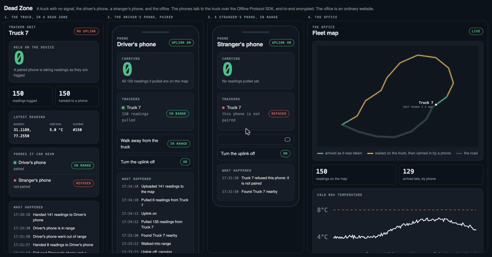

# Dead Zone

**A tracker that keeps logging with no signal, and hands its backlog,
end-to-end encrypted, to a phone that comes within range.**

For anyone who builds devices that leave coverage: trackers on trucks,
sensors in the field, meters in basements. Today such a device saves its
data and uploads it when the signal comes back. Dead Zone shows the other
way out: the data leaves through a nearby phone, before the device ever
sees a network, and nobody but the paired phone can take it.

It runs on the [Offline Protocol SDK](https://github.com/Offline-Protocol/offline-protocol-sdk).
The SDK finds the devices, forms an MLS session between them and carries
the messages; there is no server between the truck and the phone.



## The story, in four beats

1. **The truck logs.** A position and a cold-box temperature every second,
   written to its own disk. It has no uplink at all.
2. **The driver's phone walks away.** The truck keeps logging and the
   *held* count climbs. The office map goes stale: its newest reading gets
   older by the second.
3. **The phone comes back.** The truck sees it, and the whole backlog
   crosses in a few seconds. On the map the missing road fills in, in
   amber: readings that waited on the truck and were carried in by a phone.
4. **A stranger's phone was in range the whole time.** It asked. It was
   refused, and it holds nothing.

Switch the phone's uplink off before it walks back and there is a fifth
beat: the phone carries the readings in its pocket until it has a network.

## Run it

Needs Python 3.10 or later, on macOS (Apple silicon) or Linux.

```bash
python3 -m venv .venv
.venv/bin/pip install -e '.[dev]'
.venv/bin/deadzone rehearse --fresh --open
```

That starts everything on this machine: three SDK services (the truck, the
driver's phone, a stranger's phone) linked over loopback, the office map,
and a stage page that shows all four. The two switches on the driver's
phone tell the story:

- **Walk away from the truck / Walk back to the truck** cuts and joins the
  link between the two services.
- **Turn the uplink off / on** stops and starts the phone's uploads.

`--start-away` begins with the phone out of range, `--start-offline` with
its uplink off.

```bash
.venv/bin/python -m pytest          # about half a minute; DEADZONE_FAST=1 skips the three-service run
```

## On real devices

Each part is its own command, and Bluetooth is the default transport.

```bash
# The office: any machine the phone can reach over the internet or the LAN.
deadzone map --host 0.0.0.0

# The tracker: a Raspberry Pi or a laptop in the truck. --pair trusts the
# first collector that comes near, and remembers it.
deadzone unit --name "Truck 7" --pair

# The collector: a second laptop standing in for the phone.
deadzone collector --name "Driver's phone" --map http://OFFICE:7800
```

Carry the collector out of Bluetooth range and back. After the first
pairing, start the unit without `--pair`: it keeps the collector's address
in its home folder (`~/.deadzone/<name>/allow.json`), or takes one with
`--allow off1...`. `--transport lan` with `--listen` and `--peer` runs the
same thing over a network.

## What holds, and why

- **A reading is on the truck's disk before anything else happens to
  it**, and it stays held until a phone says it has stored it. The cursor
  moves on an acknowledgement and on nothing else, so a batch lost at the
  edge of range is sent again.
- **The phone stores a batch before it acknowledges it.** The truck
  forgets a reading only after that. A phone that dies mid-batch costs
  nothing.
- **Who may collect is the truck's decision, by address.** The address is
  what the encrypted session authenticates. The role a device announces
  is a claim, so a stranger that calls itself a collector is refused.
- **The phone is the recipient, then an ordinary HTTP client.** Nothing
  passes through it that it did not first store. It is not a transparent
  relay, and the demo does not pretend it is.
- **Everything is counted once.** A reading is keyed by the truck's
  address and its own counter on the phone and on the map, so a batch or
  an upload that arrives twice changes nothing.
- **The pages are displays.** Each page shows one device's state and a
  few switches. No reading moves through a page or between pages.

## What this demo does not claim

- **Battery.** Finding nearby devices costs power, on this stack as on
  any other, and nothing here measures it. A unit that is to run for
  months on a cell needs a duty cycle and a measured current, and that
  number belongs next to this demo before it is shown to someone whose
  first question is power.
- **A microcontroller.** The unit here is the full SDK on a Linux or
  macOS host. The SDK's leaf crate puts a constrained device on the same
  encrypted sessions, and porting this unit to it is the next step, not a
  thing this repository does.
- **A phone app.** The collector is a Python program with a phone-shaped
  page. On a real phone it would be the same logic on the SDK's Swift,
  Kotlin or React Native binding.
- **Real sensors.** The position and temperature are simulated
  (`deadzone/route.py`); a real unit replaces `Sensors.read`.
- **Radio range on one machine.** In the rehearsal, "out of range" is a
  cut loopback link (`deadzone/link.py`). On real hardware, distance does
  it.

## Files

```
deadzone/unit.py        the tracker: sample, log, hand off to a paired collector
deadzone/collector.py   the phone: pull, store, upload when there is an uplink
deadzone/cloud.py       the office map: takes uploads over HTTP, no SDK in it
deadzone/mesh.py        hello and JSON envelopes over the SDK's 1:1 messages
deadzone/store.py       the truck's log and the phone's store (SQLite)
deadzone/route.py       the simulated road and cold box
deadzone/link.py        rehearsal only: a loopback link that can be cut
deadzone/service.py     starts offline-protocol-service for one device
deadzone/rpc.py         the SDK's local API client (JSON-RPC over a Unix socket)
deadzone/web.py         one small page server, shared by all three
deadzone/web/           the pages: unit, phone, map, stage
```
